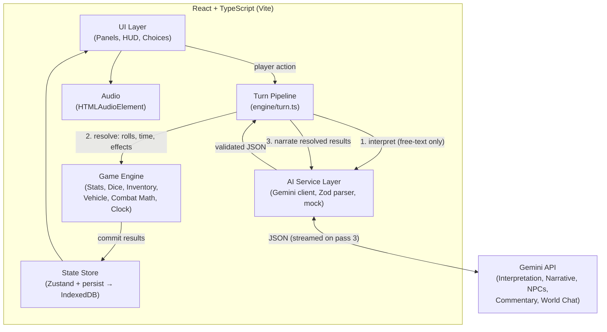

# 🛣️ Road Survival — Game Build Plan (v2, audited)

> **Note:** This is the local workspace copy of the master build plan for **Road Survival**, a hybrid browser-based survival road RPG with an AI-powered Game Master, built from the rules in `Survival Guide.txt` (the "Guide").
>
> **v2 (2026-11-24):** audited against the Guide. Every change from v1 is listed in [Audit Log](#audit-log-v1--v2) at the end. Rules the Guide leaves ambiguous are pinned in [Rules Clarifications](#rules-clarifications-defaults) — these are defaults; change them there, not in code.

---

## Design Decisions Summary

| Decision | Choice |
|---|---|
| **Platform** | Web browser (desktop-first, basic mobile responsiveness) |
| **Architecture** | Hybrid — coded game engine + AI narrative (Gemini API) |
| **Framework** | React + TypeScript + Vite |
| **AI Provider** | Gemini API via `@google/genai` (key entered in Settings, personal use) |
| **Multiplayer** | Single-player (World Chat simulated by AI) |
| **Persistence** | IndexedDB (`idb-keyval`) via Zustand `persist` + JSON export/import |
| **Visual Style** | Dark-themed RPG HUD with panels (no pixel art, no AI images) |
| **Dice/Rolls** | Seeded RNG in the engine; RNG state saved; every roll logged (auditable, no rerolls) |
| **AI Responses** | Structured JSON, two-pass turn (Interpret → Narrate), Zod-validated |
| **Audio** | Subtle SFX + ambient audio (native `HTMLAudioElement`) |
| **Streaming** | Yes — narrative field streams word-by-word out of the JSON response |
| **Testing** | Vitest on all `engine/` modules from Phase 1; mock AI provider for offline play |
| **Build Approach** | Phased — headless engine first, then playable core, then incremental systems |

---

## Architecture Overview



### Key Architectural Principle: Separation of Truth

| Layer | Owns | Examples |
|---|---|---|
| **Game Engine** (coded) | All **deterministic** game state | Stats, HP, survival meters, inventory, dice rolls, talent cascade, vehicle, XP, clock, weather, carry weight, loot rarity |
| **AI Layer** (Gemini) | All **creative** content + **interpretation** of free-text actions | Narrative, NPC dialogue, world chat, commentary, flavour names, mapping "I climb the billboard" → a Strength/Agility check |
| **State Store** | Single source of truth | Zustand store hydrated from IndexedDB; AI never mutates state directly |

**The rule that makes this work:** anything with a number, rarity, or roll is resolved by the engine **before** the AI narrates it. The AI narrates results it is handed; it never invents a number, an item rarity, damage, or a time skip. Soft effects (relationship nudges, new rumours, quest proposals) may be *proposed* by the AI after narration and are validated/clamped by the engine (see [Turn Pipeline](#turn-pipeline)).

---

## Turn Pipeline

The v1 plan said "engine validates mechanical claims in the AI response" but gave the AI nowhere to put them, and had no step where a free-text custom action becomes a dice roll. This pipeline closes that gap.

```
Player action
 ├─ Structured action (choice with action.type, or HUD button: Upgrade / Open Chest / Equip …)
 │     → skip to RESOLVE
 └─ Free-text (custom action, or choice with action.type = "freeform")
       → PASS 1 INTERPRET (AI, small, non-streamed)
            returns intent, feasibility, checks, time-cost band, loot opportunity, targets
       → if infeasible: show in-world reason, no time passes, player retries

RESOLVE (engine, pure, tested)
   - roll checks (stat + traits + luck near-miss), talent cascade, loot, combat round
   - advance clock by clamped time cost; tick survival meters; midnight → recharge talent
   - apply XP (fast-learner bonus on first-time intents), level-ups, deaths
   - COMMIT to store + persist (rolls are now final — a failed narration never rerolls)

PASS 2 NARRATE (AI, streamed)
   input: state snapshot + resolved results + recent history + GM-only facts
   output: narrative, commentary, 6 choices, news/chat, npcDialogue, proposedEffects

POST (engine)
   - Zod-validate; on failure retry once with the validation error, else "Retry narration"
     button (results already committed, so retry is safe and honest)
   - validate + clamp proposedEffects, apply them, show them on the next turn
```

**Pass 1 — Interpret schema**

```typescript
{
  intent: "travel"|"explore"|"search"|"craft"|"talk"|"combat"|"rest"|"sleep"|"use_item"|"trade"|"other",
  feasible: boolean,
  infeasibleReason: string | null,          // in-world, no time consumed
  checks: { stat: StatKey, difficulty: "trivial"|"easy"|"normal"|"hard"|"extreme", reason: string }[], // max 2
  timeCostMinutes: number,                   // engine clamps to the intent's band
  exertion: "none"|"light"|"heavy",
  lootOpportunity: { category: ItemCategory, scale: "none"|"scrap"|"cache"|"stash" } | null,
  targetIds: string[]                        // must be ids present in state; unknown ids dropped
}
```

**Pass 2 — Narrate schema** (property order matters: `narrative` first so it can stream)

```typescript
{
  narrative: string,              // vivid scene; must not state numbers not present in results
  commentary: string | null,      // null only on the very first turn
  choices: [                      // exactly 6
    { id: string, text: string, risk: "low"|"medium"|"high"|"extreme", hint: string,
      action: { type: "freeform"|"upgrade"|"special_upgrade"|"open_chest"|"travel"|"rest"|"combat_option"|"chat",
                targetId?: string } }
  ],
  worldNews: string | null,       // only rendered if the engine scheduled an announcement
  worldChat: { username: string, message: string, type: "panic"|"brag"|"trade"|"scam"|"rumor"|"joke"|"death" }[], // 0–5; rendered only when engine flag chatVisible
  npcDialogue: { npcId: string, dialogue: string, emotion: string }[],
  proposedEffects: {
    relationDeltas: { npcId: string, trust: number, respect: number, affection: number }[], // clamped ±10 each
    newNpcs: { name: string, personality: string, goal: string, secret: string }[],          // engine assigns ids/stats
    questProposals: { title: string, objective: string, rewardTier: Rarity, risks: string }[],
    rumors: { text: string, truth: "true"|"false"|"half" }[],                                 // GM-only truth
    newChatUsers: { username: string, persona: string }[]
  },
  suggestedEvents: { type: string, description: string, severity: number }[], // engine decides
  ambiance: string                // audio selection only
}
```

- `upgrade` / `special_upgrade` / `open_chest` choices are executed by the engine, never narrated as already done. **Chests only open through an explicit player action** (Prime Directive 3) — the engine has no other code path that opens one.
- Weather and time are **not** in the AI output (v1 had `environmentUpdate.weather/timeOfDay`, which contradicted the engine owning them).

---

## Rules Clarifications (defaults)

The Guide is ambiguous or silent on these. Defaults below are what the engine implements; each lives in `engine/constants.ts` so it can be tuned in one place.

| # | Topic | Default |
|---|---|---|
| C1 | **Talent odds** | Guide §5.1 table wins: Secondary 50%, Tertiary 15%, Gacha 0.05%. The example line in §5.1 ("30%", "5%") is a display-format example only. |
| C2 | **Tier cap** | Mythical is the ceiling. Cascade stops at Mythical. Mythical items are not valid targets (UI disables; no wasted charge). |
| C3 | **Special charge** | Flat +3 tiers, no cascade, clamped at Mythical. Counts as the item's one upgrade (`Upgraded ✔`). Ready at game start; the 72 h cooldown starts on use (game-clock hours). Shown in Player Status as `Special: Ready` / `Ready in 41h`. |
| C4 | **Gacha roll** | Rolled only if Tertiary succeeds (cascade). Rolled as a float; displayed with 2 decimals of percent (`rolled 0.03%`). Success jumps straight to Mythical regardless of current tier. |
| C5 | **Charges** | Reset to 6/6 at 00:00 game time; unused charges lost. Special charge never resets, only cools down. |
| C6 | **Upgrade targets** | Allowed: weapons, armor, chests, blueprints, vehicle parts (installed or loose), consumables, equipment, resources. Not allowed: skills, pets, artifacts, talents, currency. A bundle (e.g. 50× water) is one item (Guide §6) and upgrades as a whole. |
| C7 | **Crafting lineage** | Inputs lose eligibility (consumed). Crafted outputs are new items and may be upgraded once. |
| C8 | **XP, levels, vehicle** | One shared level (Guide §8.6: "Vehicles/Players gain XP"). Each level-up grants **1 upgrade point**; points bank. Until 12 paths are active, a point can only **activate** a path. Activating the 12th path shows a warning listing the 3 paths that will lock forever and requires explicit confirm. After that, points advance an active path one level (branch choice + materials). Blueprints advance an active path without spending a point (tracked as off-slot). *Interpretation of Guide §8.4's "vehicle upgrades levels only after 12 levels" — confirmed 2026-11-24.* |
| C9 | **Vehicle evolution** | Milestone levels (tunable): Explorer Van L5 → Armored Survival Van L10 → Mobile Fortress L20 → Land Cruiser L30 → Hover Fortress L45 → Legendary Mobile Citadel L60 → Mythical World Fortress L80. Each has a scripted rules change (see Phase 2). |
| C10 | **Luck** | Hidden 0–100, starts 80. Affects: loot rarity weighting, second at-tier chest item chance, near-miss saves (a check failed by a small margin has a luck-scaled chance to become a partial success), random-event favourability. **Never touches the talent cascade.** UI shows a descriptor band only (e.g. ≥75 "fortune smiles favourably"). Lucky charms raise it, cap 100. |
| C11 | **Starter chests** | Player: Purple 55 / Black 35 / Red 10. NPC players (for chat flavour): Uncommon 50 / Silver 35 / Gold 15. |
| C12 | **Chest loot** | Item count = tierIndex + 1 + d(0–1), min 2 (Common=0 … Mythical=8). Guaranteed 1 item at the chest's tier; 2nd at-tier item chance = 2% × (1 + luck/50). Remaining slots roll from lower tiers. Bundle sizes: Common 3, Uncommon 5, Silver 10, Gold 20, Orange 50, Purple 100, Black 200, Red 500, Mythical 1000 (Purple+ extrapolated from Guide §6). Contents rolled at open time from the chest's current rarity. |
| C13 | **Carry weight** | Max = 20 + 2 × Strength kg (40 kg at start). Van storage is separate and scales with the Storage component's rarity. Over max = Agility/Energy penalties, not a hard block (Guide §7.1: let them make the mistake). |
| C14 | **Time costs** | Each intent has a min–max minute band in `constants.ts`; AI suggestion clamped into it. Single actions cap at 4 h, except `sleep` when the player asks for it. No other time skip exists. |
| C15 | **Traits** | Fast learner: +25% XP the first time each intent/action type is done. Calm under pressure: −30% Sanity loss from panic events. Highly observant: +15% on Perception checks and hidden-detail rolls. Strategist: one free enemy-tell reveal per fight. Physically average: exertion fatigue ×1.2 until Strength and Endurance ≥ 14. |
| C16 | **Death** | HP 0 → engine death state. Last-chance offered only if state holds an item/quest/talent flagged `lastChance`. Otherwise the run ends; save is kept read-only. No undo exists anywhere. |
| C17 | **Response format** | Guide §18's 12 text sections become persistent HUD panels. The AI produces only narrative-side fields. Guide §20.1's Game State block **is the store** (exportable as JSON); the AI never writes it. |
| C18 | **Hidden info** | Exact luck, rumour truth, NPC secrets, the novice guardian-immunity mechanic, and other players' items are sent to the AI in a `gmOnly` context section with an instruction never to reveal them, and are never rendered in the UI (dev-mode debug panel only). |
| C19 | **World Chat gating** | Engine sets `chatVisible` only on a system announcement or a player chat/trade/read action (Guide §11). Chat usernames, reputations and scammer identities live in a persisted roster passed to the AI each time chat is visible. |
| C20 | **Before combat exists** | Until Phase 4 ships, pass 1 maps fights to opposed checks, and the prompt forbids lethal or boss encounters (Prime Directive 4 can't be honoured without the combat engine). |

### Vehicle components ↔ upgrade paths

Guide §8.1 lists 12 components; §8.3 lists 15 paths. They are not the same list, so the mapping is explicit:

| Upgrade path | Backing component | Notes |
|---|---|---|
| Tires, Windows, Chassis, Armor, Engine | same-named component | path level + component rarity both scale stats |
| Storage Space | Storage | |
| Radar / Sensors | Sensors | |
| Headlights, Lighting | Lighting | Headlights = exterior/forward; Lighting = interior/utility |
| Living Space, Kitchen, Music & Entertainment, Weapons, AC, Water | — (interior modules) | path-only; draw on Power Source |
| — | Transmission, Suspension, Fuel System, Power Source | no path; improved by part swaps, blueprints, or the talent |

---

## Project Structure

```
d:\RoadSurvival\
├── index.html                # Vite entry lives at the root (v1 wrongly had it in public/)
├── public/
│   └── audio/
│       ├── sfx/              # dice-roll, chest-open, hit, alert
│       └── ambient/          # wasteland, rain, night
├── src/
│   ├── main.tsx
│   ├── App.tsx
│   ├── engine/               # Pure game logic (no React), each module has a *.test.ts
│   │   ├── types.ts          # All TypeScript interfaces & enums
│   │   ├── constants.ts      # Rarity tiers, stat baselines, XP table, Rules Clarifications C1–C20
│   │   ├── dice.ts           # Seeded PRNG (state in save), roll log, checks, talent cascade, special charge
│   │   ├── turn.ts           # Resolve step of the turn pipeline (actions → rolls → effects → commit)
│   │   ├── clock.ts          # Day/time advance, midnight recharge, cooldowns, novice period flag
│   │   ├── survival.ts       # Hunger, thirst, energy, fatigue, sanity, temperature
│   │   ├── inventory.ts      # Add/remove, carry weight, upgrade flags, bundles, blueprints
│   │   ├── loot.ts           # Chest generation & opening (C11, C12), luck weighting
│   │   ├── vehicle.ts        # Components, paths, activation/locking, evolution
│   │   ├── combat.ts         # Damage, turn resolution, weaknesses, rewards
│   │   ├── world.ts          # Weather, events, waves
│   │   ├── npcs.ts           # NPC state, relationship clamps
│   │   ├── quests.ts         # Quest tracking
│   │   ├── economy.ts        # Currency, pricing
│   │   ├── xp.ts             # XP, level-up, upgrade points, titles/achievements
│   │   └── data/             # Authored content (see "Content authoring" tasks)
│   │       ├── items.ts      # Item templates: category, weight, base stats
│   │       ├── upgradeTree.ts# 15 paths × levels × branches
│   │       ├── enemies.ts    # Enemy & guardian templates by tier
│   │       ├── talents.ts    # Secondary talent pool
│   │       └── events.ts     # Random event pool
│   ├── ai/
│   │   ├── client.ts         # @google/genai client, streaming, retry, rate-limit backoff
│   │   ├── mock.ts           # Offline provider returning canned valid JSON (dev + tests)
│   │   ├── prompts.ts        # System prompt, context serializer (public + gmOnly sections)
│   │   ├── schemas.ts        # Zod schemas for pass 1 / pass 2 (JSON schema derived from these)
│   │   └── stream.ts         # Incremental extractor for the "narrative" field of streamed JSON
│   ├── store/
│   │   └── gameStore.ts      # Zustand store + persist(idb-keyval); no undo
│   ├── components/
│   │   ├── layout/           # GameLayout, TopBar, PanelContainer
│   │   ├── panels/           # PlayerStatus, Inventory, VehicleStatus, UpgradeTree, QuestLog, WorldChat, WorldNews, RollHistory
│   │   ├── narrative/        # NarrativePanel, Commentary, ChoicePanel
│   │   ├── combat/           # CombatView, EnemyCard, CombatLog
│   │   ├── overlays/         # DiceRoll, TalentCascade, ChestOpen, LevelUp, LockPathsConfirm, Death
│   │   └── meta/             # SaveLoad, Settings, StartScreen, DebugPanel (dev only)
│   ├── hooks/
│   │   ├── useGameTurn.ts    # Drives the turn pipeline from the UI
│   │   └── useAudio.ts
│   ├── utils/
│   │   ├── rarity.ts         # Rarity colour/emoji mapping
│   │   └── formatters.ts
│   └── styles/
│       ├── global.css        # CSS variables, dark theme tokens
│       ├── panels.css
│       └── animations.css    # Dice, cascade, chest animations
├── .env.local                # optional dev-only VITE_GEMINI_API_KEY (git-ignored, never deployed)
├── package.json
├── tsconfig.json
├── vite.config.ts            # also holds Vitest config
├── GAME_BUILD_PLAN.md
└── Survival Guide.txt
```

---

## Phased Build Plan

### Phase 1a: Headless Engine Core 🧮
**Goal:** All Day-1 rules work and are tested with no UI and no AI.

| Task | Details | Files |
|---|---|---|
| **1.1** Project setup | `npm create vite@latest` (react-ts), add Zustand, Zod, `@google/genai`, `idb-keyval`, Vitest | `package.json`, `vite.config.ts`, `tsconfig.json` |
| **1.2** Types & constants | `Player`, `Item`, `Vehicle`, `Rarity`, `GameState`, `TreasureChest`, `SurvivalMeters`, `RollRecord`; Qing Zhou's fixed stats (Str 10, Agi 10, End 10, Int 14, Per 15, Cha 10, Luck 80) and traits; all C1–C20 constants | `engine/types.ts`, `engine/constants.ts` |
| **1.3** Dice & talent | Seeded PRNG with persisted state; roll log; stat checks with luck near-miss; cascade (C1, C2, C4); special charge (C3); one-upgrade-per-item flag | `engine/dice.ts` |
| **1.4** Clock | Starts 06:00 Day 1; time advance with clamped bands (C14); midnight recharge (C5); 72 h cooldown; novice-period flag (Days 1–7) | `engine/clock.ts` |
| **1.5** Survival & XP | Meter decay per minute and exertion; trait modifiers (C15); XP, fast-learner bonus, level-up → upgrade points (C8); death state (C16) | `engine/survival.ts`, `engine/xp.ts` |
| **1.6** Inventory & chests | Item CRUD, bundles, carry weight (C13), starter chest roll (C11), chest open (C12) — moved here from Phase 3 because the first turn offers *Upgrade* and *Open* | `engine/inventory.ts`, `engine/loot.ts`, `engine/data/items.ts` (starter set) |
| **1.7** Vehicle stub | Common Van: 12 components at Common, fuel, wear, durability (full system in Phase 2) | `engine/vehicle.ts` |
| **1.8** Resolve step | Structured actions + check-based free-text resolution → committed state | `engine/turn.ts` |
| **1.9** Tests | Cascade odds over 100k seeded rolls within tolerance; no talent use on an `Upgraded ✔` item; Mythical clamp; chest always has ≥1 at-tier item; charges reset at midnight; save→load keeps RNG state (no reroll) | `engine/*.test.ts` |

### Phase 1b: Playable Day 1 🏗️
**Goal:** A playable opening — arrival scene, talent reveal, unopened chest, six choices, streamed AI narrative.

| Task | Details | Files |
|---|---|---|
| **1.10** State store | Zustand + `persist` with `idb-keyval` storage; no undo/redo (it would allow rerolling talent results, violating Guide §5.1 and Prime Directive 5) | `store/gameStore.ts` |
| **1.11** AI integration | Pass 1 + pass 2 schemas; structured-output JSON schema derived from the Zod schemas; streamed narrative extraction; Zod validation + one repair retry + "Retry narration" fallback; mock provider | `ai/*` |
| **1.12** Prompt | Condensed Guide rules relevant to the AI (role, tone, commentary rules, choice rules, never-reveal list), public + `gmOnly` context, last 5 turns + important-decisions log | `ai/prompts.ts` |
| **1.13** UI: layout & theme | Dark theme tokens, grid layout (sidebar panels + centre narrative) | `styles/*`, `components/layout/*` |
| **1.14** UI: core panels | Player Status (incl. `Upgrade X/6`, special charge state, luck descriptor), Vehicle Status (stub), Inventory (Upgrade/Open buttons per item), Narrative, Commentary, Choices (6 + custom), Roll History | `components/panels/*`, `components/narrative/*` |
| **1.15** UI: dice & cascade | Overlay showing each stage `🎲 Primary: 100% → ✅ \| Secondary: 50% (rolled 17) → ✅ \| Tertiary: 15% (rolled 63) → ❌`, stopping at the first failure | `components/overlays/DiceRoll.tsx`, `TalentCascade.tsx` |
| **1.16** Start & Settings | New game (fixed character), continue, API key input (stored in this browser's localStorage), model name setting | `components/meta/*` |

> [!TIP]
> **Phase 1 deliverable:** start a new game at 06:00 Day 1, see the arrival scene, the talent and the unopened chest, upgrade the chest and/or open it, pick from 6 choices or type a custom action, watch the rolls, read streamed narrative, see status update — and play the whole thing offline with the mock provider.

---

### Phase 2: Vehicle & Upgrade Systems 🚐

| Task | Details | Files |
|---|---|---|
| **2.1** Vehicle engine | 12 components × independent rarity, durability, fuel, wear; component↔path mapping table above | `engine/vehicle.ts` |
| **2.2** Content authoring: upgrade tree | 15 paths, each ≥3 levels with ≥3 distinct branch identities per level whose choice changes the next level's options (Guide §8.4). Authored data, not AI-generated — the AI can't keep a tree consistent across sessions | `engine/data/upgradeTree.ts` |
| **2.3** Path logic | Activation with upgrade points (C8), lock-3 confirm with warning, branch selection, material costs, off-slot blueprint upgrades tracked separately | `engine/vehicle.ts` |
| **2.4** Evolution | Milestones (C9). Each stage gets a concrete rules change (e.g. Armored Survival Van: ram attacks; Mobile Fortress: stationary defence mode vs waves; Hover Fortress: ignores terrain penalties) plus a narrative evolution scene | `engine/vehicle.ts` |
| **2.5** UI | Vehicle panel with rarity badges and bars; interactive tree (active / locked / available / off-slot) | `components/panels/VehicleStatus.tsx`, `UpgradeTree.tsx`, `overlays/LockPathsConfirm.tsx` |
| **2.6** Blueprints & crafting | Discovery, permanent unlock, craft-from-blueprint, lineage rule (C7) | `engine/inventory.ts` |

---

### Phase 3: Loot Content & Chest Ceremony 🎁
(Chest rules moved to Phase 1a.)

| Task | Details | Files |
|---|---|---|
| **3.1** Content authoring: items | Item templates per category with weight and base stats; rarity scaling; AI may supply a flavour name only | `engine/data/items.ts` |
| **3.2** World chests | Open-world low-tier chests; guarded high-tier chests with guardian tier scaled by rarity (guardian templates from Phase 4 data) | `engine/loot.ts` |
| **3.3** UI: chest opening | Rarity glow, item-by-item reveal, rarity SFX | `components/overlays/ChestOpen.tsx` |

---

### Phase 4: Combat System ⚔️

| Task | Details | Files |
|---|---|---|
| **4.1** Combat engine | Damage formulas, stat/weapon/armor modifiers, status effects, weakness discovery via Perception, terrain & weather modifiers | `engine/combat.ts` |
| **4.2** Content authoring: enemies | Templates by tier/rarity with behaviour patterns, morale, tells, weaknesses; AI picks a template id and flavours it, engine owns the stats | `engine/data/enemies.ts` |
| **4.3** Combat AI context | AI describes terrain/behaviour and offers tactical options mapped to `combat_option` actions; engine resolves | `ai/prompts.ts` |
| **4.4** UI | Enemy cards (observed, not full stats), damage log, tactical choices; escape route always visible (Guide §13) | `components/combat/*` |
| **4.5** Rewards & secondary talents | XP/loot by tier; secondary talent roll on boss kills (low base, scales with tier); talent pool authored, none a superset of Upgrade (Guide §5.3) | `engine/combat.ts`, `engine/data/talents.ts` |
| **4.6** Novice guardians | During Days 1–7, chest guardians deal no damage; foreshadowed (attacks pass through the van), never announced | `engine/combat.ts` |

---

### Phase 5: World Systems 🌍

| Task | Details | Files |
|---|---|---|
| **5.1** Weather & temperature | Dynamic weather affecting visibility, travel, combat, spawns; body temperature model | `engine/world.ts`, `engine/survival.ts` |
| **5.2** Novice period end | Day 8 World Announcement; player encounters enabled; secondary talents enabled | `engine/world.ts` |
| **5.3** Monster waves | Schedule with warning window, escalation by day and region danger, always an escape or counter | `engine/world.ts` |
| **5.4** Random events | Authored pool, rolled (not always triggered), max one major per turn, foreshadowed ≥1 turn ahead, ≥2 approaches each, build-aware | `engine/world.ts`, `engine/data/events.ts` |
| **5.5** UI | World News banner, weather in top bar | `components/panels/WorldNews.tsx`, `layout/TopBar.tsx` |

---

### Phase 6: NPCs, Quests, Economy, Progression 👥

| Task | Details | Files |
|---|---|---|
| **6.1** NPC engine | Personality, goals, likes/dislikes, secrets (revealed gradually), combat ability, Trust/Respect/Affection 0–100; NPCs act on goals off-screen (engine tick); betrayal setup flags | `engine/npcs.ts` |
| **6.2** Quests | Active/completed/failed, objective, location, deadline, reward tier, risks | `engine/quests.ts` |
| **6.3** Economy | Survival Credits + trade goods, scarcity × rarity pricing, merchant inventories/reputation persisted | `engine/economy.ts` |
| **6.4** World Chat | Persistent roster (C19), rumour registry with truth values, scammers repeat; trade offers priced from the economy engine | `components/panels/WorldChat.tsx`, `engine/world.ts` |
| **6.5** Titles & achievements | Earned from milestones; shown in Player Status (Guide §9) — missing from v1 | `engine/xp.ts` |
| **6.6** UI: quest log | Tabbed panel | `components/panels/QuestLog.tsx` |

---

### Phase 7: Audio, Saves & Polish 🔊

| Task | Details | Files |
|---|---|---|
| **7.1** Audio | SFX triggers + ambient loop selected by `ambiance` and weather; mute toggle | `hooks/useAudio.ts`, `public/audio/*` |
| **7.2** Saves | Multiple slots, JSON export/import (autosave already exists from Phase 1) | `components/meta/SaveLoad.tsx` |
| **7.3** Animations | Panel transitions, stat-change flashes (CSS) | `styles/animations.css` |
| **7.4** Tutorial hints | Non-intrusive, dismissible | various |
| **7.5** Error handling | Offline banner, rate-limit backoff, quota messages (basic validation/retry already in Phase 1) | `ai/client.ts` |

---

## AI Prompt Architecture

### System prompt (built each call)

```
[ROLE]        Game Master / Narrator / NPC voice. Stay in role; [OOC] only for rules questions.
[RULES]       Condensed from the Guide: Prime Directives 1–7, tone & style (§1), commentary rules (§17),
              choice rules (§18), chat rules (§11), event rules (§12), romance pacing (§15).
              Never state a number, rarity, item, or time jump that is not in RESOLVED RESULTS.
[STATE]       Public snapshot: day/time, weather, location, meters, stats (no luck number),
              inventory, vehicle, quests, known NPCs.
[GM_ONLY]     Hidden facts — never reveal: luck band, rumour truths, NPC secrets,
              novice guardian immunity, other players' items.
[RESULTS]     What the engine resolved this turn (rolls, outcomes, loot, damage, time passed).
[HISTORY]     Last 5 turns (action + one-line outcome) + persistent important-decisions log.
[INSTRUCTION] Return ONLY JSON matching the schema.
```

- **Long-term memory:** the store keeps an `importantDecisions` log and NPC/rumour registries, so continuity doesn't depend on the 5-turn window.
- **Model:** configurable in Settings; default to the current Gemini Flash model for speed/cost.
- **Streaming:** Gemini streams the JSON text; `ai/stream.ts` reads the `narrative` string out of the partial buffer as it grows (decoding escapes) so the UI streams prose before the full object arrives. Full Zod validation runs at the end.

---

## Key Technical Decisions

### State management: Zustand
- Built-in `persist` middleware with an `idb-keyval` storage adapter — no custom middleware.
- **No undo/redo.** Turn history is kept read-only (for the log and AI context).
- RNG state is part of the saved state, so reloading never changes an outcome.

### API key handling
- `VITE_*` variables are compiled into the JS bundle in plain text. Default: the player pastes the key in Settings; it's stored in this browser's localStorage. `.env.local` is an optional dev convenience only.
- Never deploy a build with a key in it. If the game is ever hosted for others, add a small server-side proxy first.

### Styling: plain CSS files + CSS variables
(v1 said "CSS Modules" but the file tree used plain files; plain files chosen.)

### Rarity colour tokens

```css
:root {
  --rarity-common:    #9d9d9d;
  --rarity-uncommon:  #1eff00;
  --rarity-silver:    #c0c0c0;
  --rarity-gold:      #ffd700;
  --rarity-orange:    #ff8c00;
  --rarity-purple:    #a335ee;
  --rarity-black:     #4a4a6a;   /* v1's #1a1a2e was invisible on the dark theme; pair with the glow below */
  --rarity-black-glow:#d8d8ff;
  --rarity-red:       #ff2a2a;
  --rarity-mythical:  #ff4fd8;   /* solid fallback for borders/text */
  --rarity-mythical-gradient: linear-gradient(90deg, #ff0000, #ff8c00, #ffd700, #1eff00, #00bfff, #a335ee);
}
```
The gradient is not a valid `color` value; apply it via `background-image` + `background-clip: text` for text and `border-image` for borders. Every rarity label also carries its emoji prefix (⚪🟢🔘🟡🟠🟣⚫🔴🌈) so it never relies on colour alone.

---

## Estimated Effort Per Phase

| Phase | Estimated Effort | Cumulative |
|---|---|---|
| **1a** Headless engine core | 2–3 days | 2–3 days |
| **1b** Playable Day 1 | 3–4 days | 5–7 days |
| **2** Vehicle & upgrades (incl. tree authoring) | 3–5 days | 8–12 days |
| **3** Loot content & ceremony | 1–2 days | 9–14 days |
| **4** Combat (incl. enemy/talent authoring) | 3–4 days | 12–18 days |
| **5** World systems | 2–3 days | 14–21 days |
| **6** NPCs, quests, economy, progression | 3–4 days | 17–25 days |
| **7** Audio, saves, polish | 2–3 days | 19–28 days |

v1's 14–21 days had no time for content authoring (upgrade tree, items, enemies, talents, events) or tests.

---

## Dependencies (npm packages)

| Package | Purpose |
|---|---|
| `react`, `react-dom` | UI |
| `typescript`, `vite`, `@vitejs/plugin-react` | Build |
| `vitest` (dev) | Engine tests |
| `zustand` | State + `persist` |
| `zod` | AI response validation; source of the structured-output JSON schema |
| `@google/genai` | Gemini client (v1's `@google/generative-ai` is the deprecated legacy SDK) |
| `idb-keyval` | IndexedDB storage for `persist` |

Dropped from v1 until a real need shows up:
- `howler` — native `HTMLAudioElement` covers a handful of SFX and one ambient loop. Add if crossfades/sprites are needed.
- `framer-motion` — CSS animations cover dice, cascade and chest reveal. Add `motion` if layout animations are needed.
- `lucide-react` — the Guide's UI language is emoji; add if icons are wanted.

---

## Audit Log (v1 → v2)

**Critical (would block or break the build)**
1. **No path from free-text action to dice roll, and nowhere for mechanical effects to go.** Added the two-pass [Turn Pipeline](#turn-pipeline) with an Interpret schema and `proposedEffects`; numbers resolve before narration.
2. **Undo/redo in the store** let players reroll talent results (Guide §5.1 "no rerolls", Prime Directive 5). Removed; RNG state saved.
3. **AI owned weather/time** (`environmentUpdate`) while the engine was supposed to. Removed from AI output.
4. **Chest opening could be narrated by the AI.** Choices now carry a structured `action`; only explicit player actions open chests (Prime Directive 3).
5. **Phase ordering:** the first turn needs Upgrade/Open chest, the clock (midnight recharge, novice period) and vehicle status, but these were in Phases 3, 5 and 2. Moved the needed cores into Phase 1a.
6. **Streaming vs structured JSON** were both specified with no reconciliation. Added narrative-first property order + incremental extractor + final validation.
7. **Deprecated SDK** `@google/generative-ai` replaced with `@google/genai`.

**Missing Guide features**
8. Luck (hidden value, descriptor, charms, never on talent) — C10.
9. Special 72 h charge semantics — C3. Tier cap — C2.
10. Starter chest weighting, chest loot math, bundle sizes, ≥1 at-tier item — C11, C12.
11. Character traits as mechanics (fast learner, calm, observant, strategist, physically average) — C15.
12. Death & last-chance handling (Guide §7.2) — C16.
13. Secondary talents (Guide §5.3) — task 4.5. Titles & achievements (Guide §9) — task 6.5.
14. Rumour truth tracking and persistent chat roster (Guide §11) — C19, task 6.4.
15. Novice guardian immunity foreshadowing — task 4.6.
16. Carry weight formula — C13. Time-cost rules for "never skip time" — C14.
17. Hidden-info handling (what the AI may know but never reveal) — C18.

**Ambiguities in the Guide, now pinned**
18. Cascade odds table (50/15/0.05) vs example line (30/5) — C1.
19. 12 components vs 15 paths — mapping table.
20. Level-up ↔ path activation ↔ vehicle levels — C8 (confirmed), C9.
21. Upgrading bundles; which categories are upgradable — C6.

**Technical fixes**
22. `VITE_` key is bundled in plain text — key via Settings; `.env.local` dev-only.
23. `index.html` belongs at the project root in Vite, not `public/`.
24. Persistence was split three ways (localStorage in 1.6, IndexedDB in 7.2, "localStorage / IndexedDB" in summary) — one choice: `persist` + `idb-keyval` from Phase 1.
25. "CSS Modules" vs plain CSS files — plain files.
26. Black rarity colour invisible on dark theme; Mythical gradient isn't a valid `color` — tokens fixed.
27. No tests and no offline AI — Vitest from Phase 1a, mock provider in 1b.
28. Validation/retry deferred to Phase 7 although malformed JSON happens from turn one — basic retry moved to Phase 1b.
29. No content-authoring tasks (upgrade tree, items, enemies, talents, events) and effort too low — added tasks 2.2, 3.1, 4.2, 4.5, 5.4; estimate 19–28 days.
30. Three dependencies dropped (`howler`, `framer-motion`, `lucide-react`) — native/CSS covers them.
